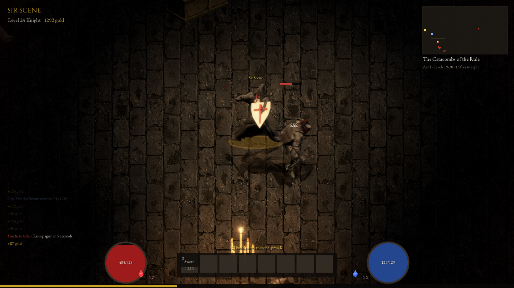

# Taco Factory rendering

The client draws each frame in four steps. Settings → **Lighting and effects** turns steps 2–3 off, for older graphics
cards; the game then draws straight to the screen as before.

1. **Scene.** Ground, scenery, figures and blood or dust particles are drawn into an offscreen picture (`PostProcess.Scene`).
2. **Light and glow.**
   - *Light* (half size, floating point) starts at the zone's ambient level (`ambience.ambient × ambience.level`).
     Drifting cloud shadows darken it outdoors, then every light is added on top: candelabra and smouldering
     beams (`props.json` → `light`), placed fires and shafts of daylight (`zones/*.json` → `lights`), exits, the
     waypoint, loot, the heroes' own light in dark places (`ambience.heroLight`), and flashes from hits and spells.
   - *Emissive* (floating point) holds what shines by itself: flames, sparks, spell trails, loot beams and boss warnings.
3. **Composite** (`PostProcess.Composite`): picture × light + emissive, then bloom (bright pass, Gaussian blur at half
   and quarter size), a filmic roll-off, colour grade (`ambience.tint`, `saturation`, `contrast`), vignette, film
   grain, a red edge when the hero is badly hurt, and a white flash on level-up and boss kills.
4. **Overlay.** Names, health bars, damage numbers and the HUD are drawn last, untouched by light or grade.

## Zone atmosphere

`tools/art/zone_ambience.py` writes every zone's `ambience` block and `lights`. It also stands candelabra along the
walls of dark interiors; those are marked `"auto": true` and are replaced each time the tool runs. Edit the `MOODS` table and run:

    python tools/art/zone_ambience.py

| ambience field | meaning |
|---|---|
| `ambient`, `level` | colour and strength of the light everything starts from (1 = full daylight) |
| `tint`, `saturation`, `contrast`, `vignette`, `bloom` | colour grade |
| `particles`, `particleDensity` | `embers`, `dust`, `snow`, `ash`, `fireflies`, `spores` or `rain` |
| `heroLight` | radius of the light the heroes carry (0 outdoors by day) |
| `clouds` | strength of cloud shadows drifting over the ground |
| `dust` | colour of footstep dust |

Run `zone_ambience.py` after `scenery.py`: it also writes each zone's ambience loop (`sound`) and dresses it with
scenery for its biome. Those pieces are marked `"auto": "scenery"`. Tall scenery (3.5 m and up) fades to about 40%
while a hero stands behind it.

## Effects

`Rendering/Particles.cs` is a pooled particle system: world positions, height above the ground with gravity, drag,
sway, streaks along motion, expanding rings, and blood that lands and stains. `GameClient.Fx.cs` turns the server's
events into effects:

- **Hits:** sparks, blood, a light flash and shake when you are hit.
- **Your blows:** a brief hit-stop that slows animation for a few frames on crits and kills.
- **Deaths:** a dust ring; boss deaths add a shockwave and a white flash.
- **Spells:** coloured by school (fire, frost, storm, holy, arcane, warding, grave): bolts with trails, bursts,
  novas, auras, drains and blinks.
- **Level-up:** a golden pillar.
- **Heals:** rising motes.
- **Boss slams:** an impact when their warning circle runs out.

The camera follows smoothly, leads in the direction of travel and shakes by "trauma" that decays.

